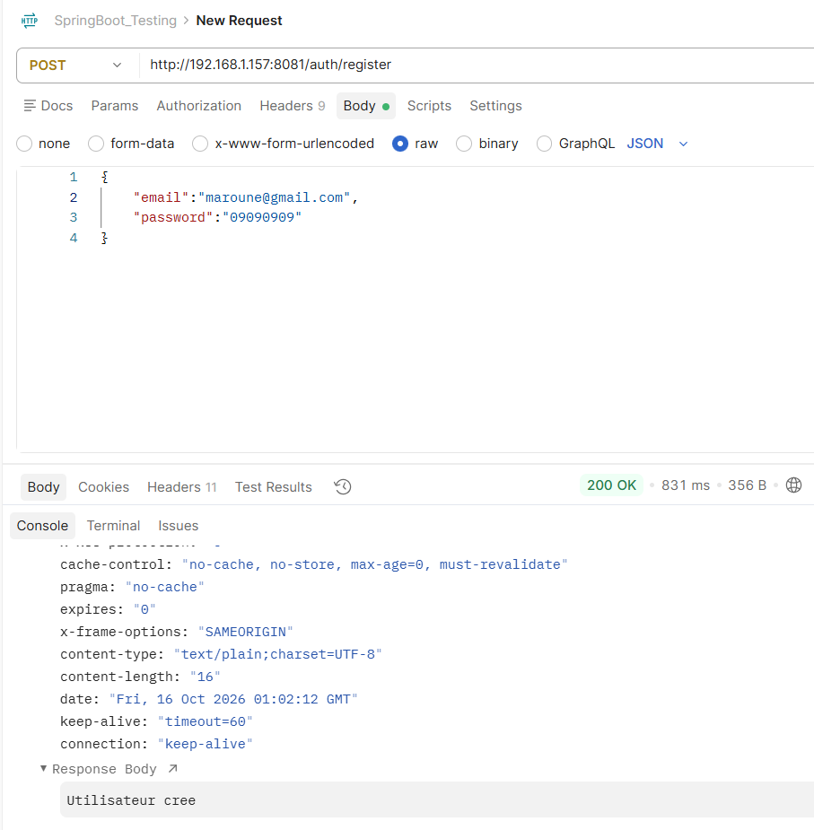
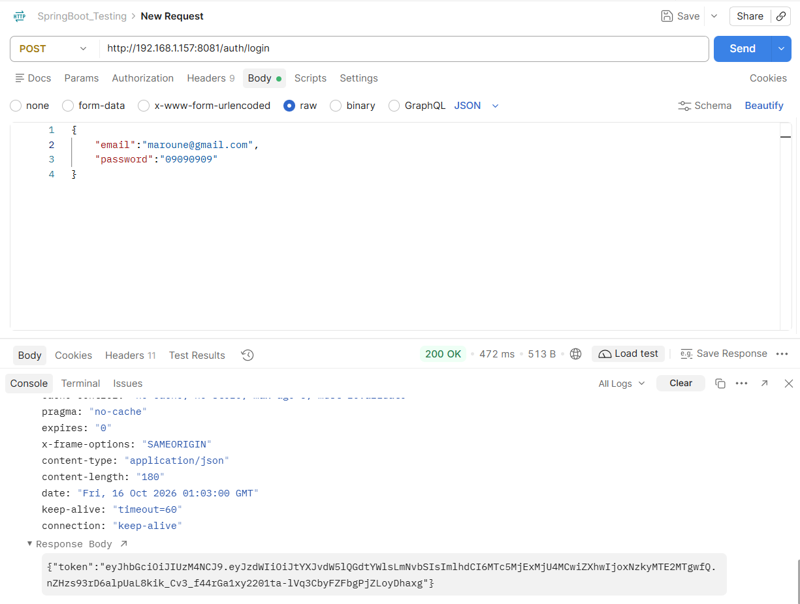
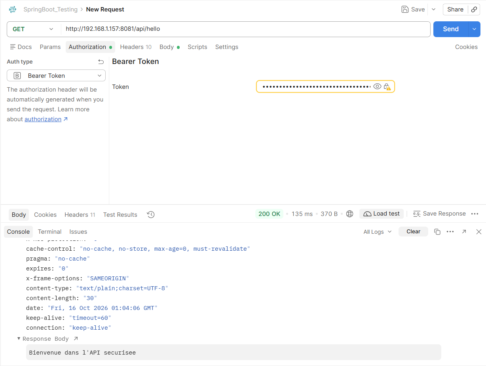
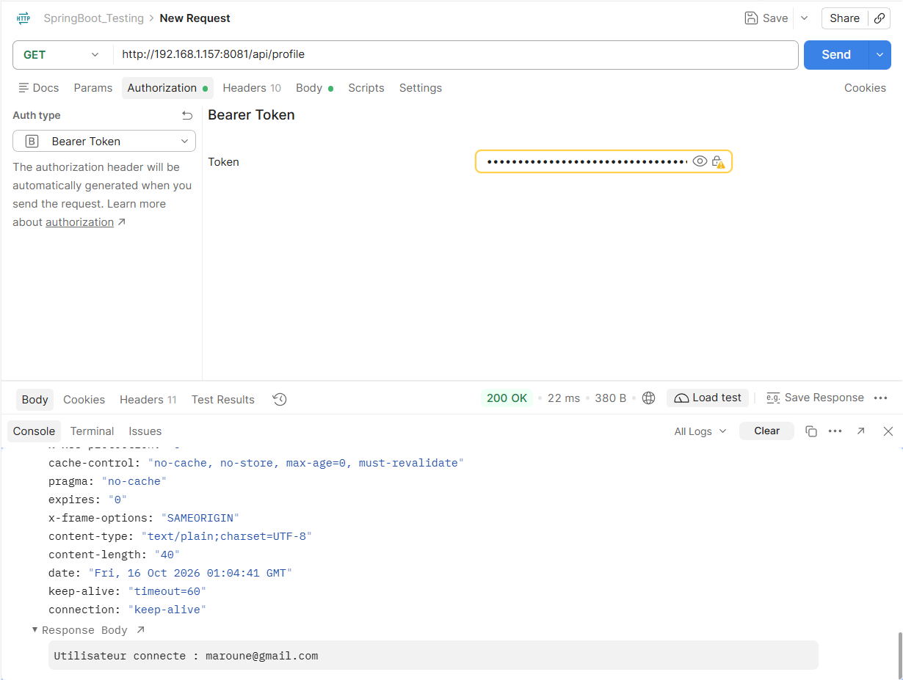

# Secure REST API with Spring Boot & JWT

A secure RESTful Web API engineered with **Spring Boot**, **Spring Security**, and **JSON Web Tokens (JWT)**. This application provides stateless user authentication, password hashing with BCrypt, and token-based route authorization.

---

## Technical Stack

* **Core Framework:** Java 21, Spring Boot
* **Security & Auth:** Spring Security, JJWT (`0.13.0`)
* **Persistence:** Spring Data JPA, H2 In-Memory Database
* **API Testing & Documentation:** Postman, Swagger UI 

---

## Project Architecture

```text
com.elbelkassmi.tp_jwt
├── config
│   └── SecurityConfig.java            # Spring Security & FilterChain setup
├── controller
│   ├── AuthController.java            # Public auth endpoints (register/login)
│   └── UserController.java            # Secured resource endpoints
├── dto
│   ├── AuthResponse.java              # JWT response payload
│   ├── LoginRequest.java              # Credentials payload
│   └── RegisterRequest.java           # Account creation payload
├── entity
│   └── AppUser.java                   # JPA User Entity
├── repository
│   └── UserRepository.java            # User persistence interface
├── security
│   ├── JwtFilter.java                 # Custom request interceptor
│   └── JwtService.java                # Token generation & verification engine
├── service
│   └── CustomUserDetailsService.java # UserDetails loader service
└── TpJwtApplication.java              # Application main entry point
```

---

## Configuration Summary (`application.properties`)

```properties
spring.application.name=tp_jwt
server.port=8081
server.address=0.0.0.0

# Database Configuration
spring.datasource.url=jdbc:h2:mem:securitydb
spring.datasource.driverClassName=org.h2.Driver
spring.datasource.username=sa
spring.datasource.password=
spring.h2.console.enabled=true
spring.h2.console.path=/h2-console

# JPA Settings
spring.jpa.hibernate.ddl-auto=update
spring.jpa.show-sql=true

# JWT Token Settings
jwt.secret=c3VwZXJzZWNyZXRrZXlmb3Jqd3RhdXRoZW50aWNhdGlvbnNwcmluZ2Jvb3RzZWN1cml0eQ==
jwt.expiration=3600000
```

---

## API Reference

| HTTP Method | Endpoint | Authorization | Functionality |
| :--- | :--- | :--- | :--- |
| `POST` | `/auth/register` | Public | Registers a new account and encrypts password via BCrypt |
| `POST` | `/auth/login` | Public | Authenticates credentials and returns a Bearer JWT |
| `GET` | `/api/hello` | Bearer Token | Accesses secured welcome resource |
| `GET` | `/api/profile` | Bearer Token | Returns identity details extracted from current security context |

---

## Verification & Testing (Postman Execution)

### 1. User Registration (`POST /auth/register`)
Dispatches user credentials (`email` and `password`). The password is encoded using `BCryptPasswordEncoder` prior to DB persistence.
* **HTTP Status:** `200 OK`
* **Payload:** `Utilisateur cree`



---

### 2. User Authentication (`POST /auth/login`)
Validates user credentials against `AuthenticationManager` and issues a cryptographically signed JWT upon successful verification.
* **HTTP Status:** `200 OK`
* **Payload:** JSON payload containing the generated `token`.



---

### 3. Protected Endpoint Authorization (`GET /api/hello`)
Executes a request passing the JWT in the standard HTTP header: `Authorization: Bearer <token>`.
* **HTTP Status:** `200 OK`
* **Payload:** `Bienvenue dans l'API securisee`



---

### 4. Authenticated Profile Context (`GET /api/profile`)
Validates subject identity dynamically parsed from the active SecurityContext.
* **HTTP Status:** `200 OK`
* **Payload:** `Utilisateur connecte : maroune@gmail.com`

